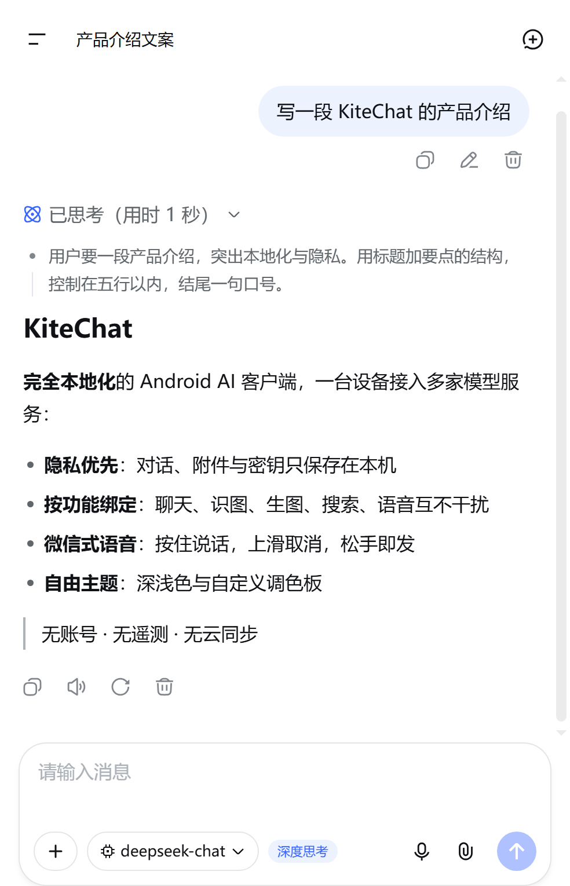
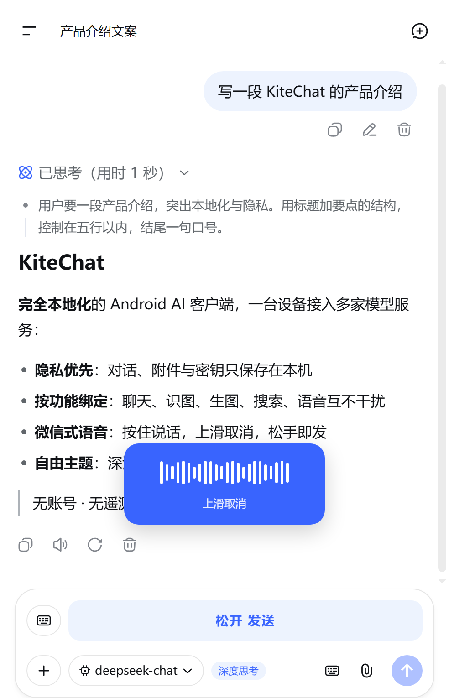
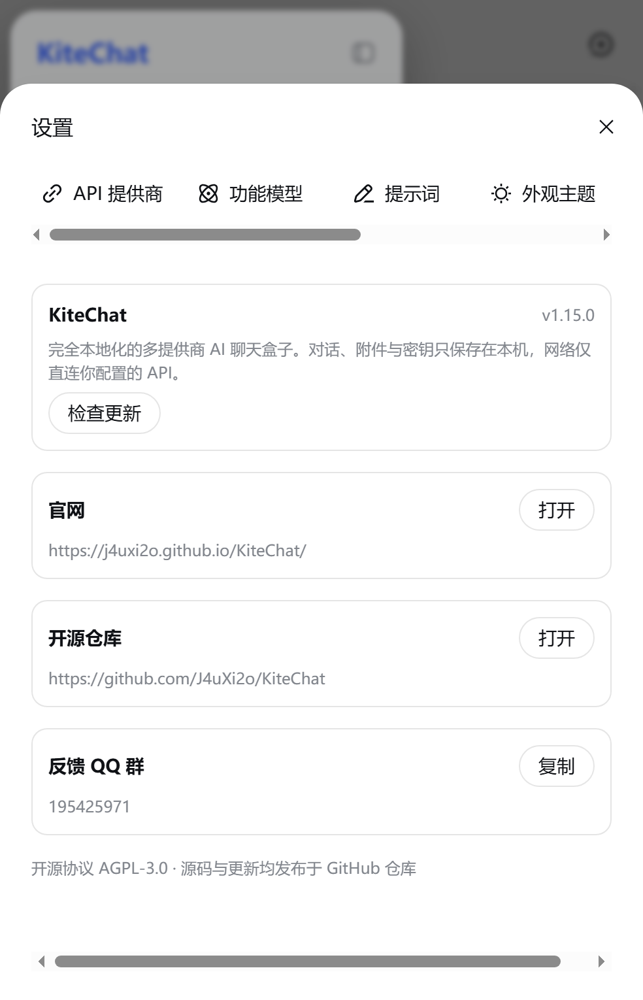

<div align="center">


# KiteChat

**A fully local, multi-provider AI chat box for Android**

[](LICENSE)
[](https://github.com/J4uXi2o/KiteChat/releases)

[Download](https://j4uxi2o.github.io/KiteChat/) · [中文文档](README.md)

</div>

---

## Overview

KiteChat is an open-source Android AI client that is not tied to any single model vendor. Chat, vision, image generation, web search and speech (ASR + TTS) are each bound to their own provider and model, so one device can use DeepSeek, OpenAI, SiliconFlow, TokenRhythm, local Ollama and more side by side.

All chats, attachments and API keys stay on the device. Network requests go only to the endpoints you configure. No accounts, no telemetry, no cloud sync.

## Highlights

- Per-feature model binding with vendor presets and custom OpenAI / Anthropic-compatible endpoints
- One-click onboarding: a single DeepSeek key provisions chat, vision, titles, search and speech
- WeChat-style voice input: hold to talk, slide up to cancel, release to auto-transcribe and send
- Image / PDF / Word attachment parsing; pasted URLs fetched as context
- Image generation with model-inferred size & count (prompt untouched) and cross-vendor img2img
- Streaming replies with real request cancellation, regeneration and branch switching
- Light / dark themes, custom palette, native text selection, Android share intake and completion notifications
- Local ZIP import / export of sessions and attachments

## Screenshots

<div align="center">



</div>

## Install

Download the APK from [Releases](https://github.com/J4uXi2o/KiteChat/releases). Overwrite installs keep all local data. Requires Android 8.0+ (API 26).

## Build from source

Requires Node.js 20+, JDK 21, Android SDK 35.

```bash
npm install
npm run build
npx cap sync android
cd android && ./gradlew assembleRelease
```

See `android/signing.properties.example` for release signing configuration.

## Feedback

QQ group: **195425971** · [Issues](https://github.com/J4uXi2o/KiteChat/issues)

## License

[AGPL-3.0](LICENSE)

---

<sub>Portions of the code originate from [deepseek-ai/chat-demo](https://github.com/deepseek-ai/chat-demo) (MIT); see [THIRD_PARTY_NOTICES.md](THIRD_PARTY_NOTICES.md).</sub>