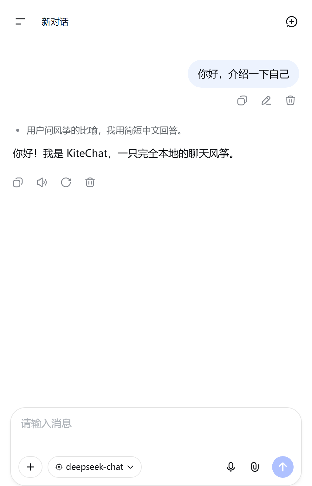
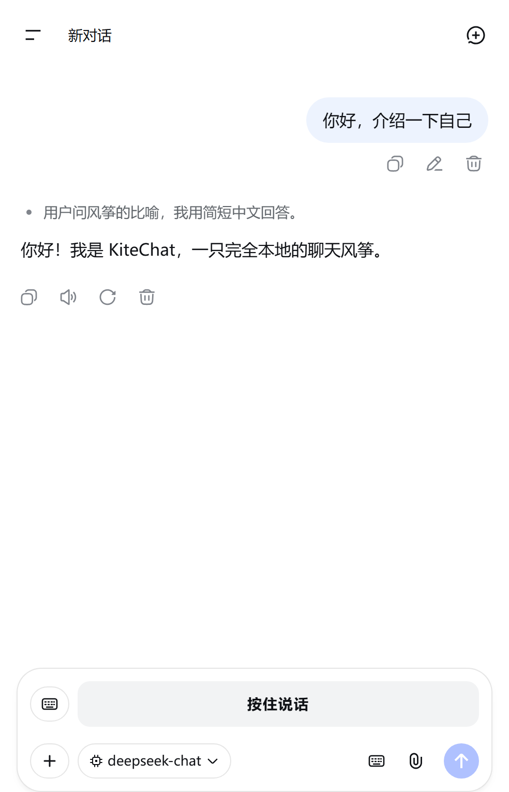
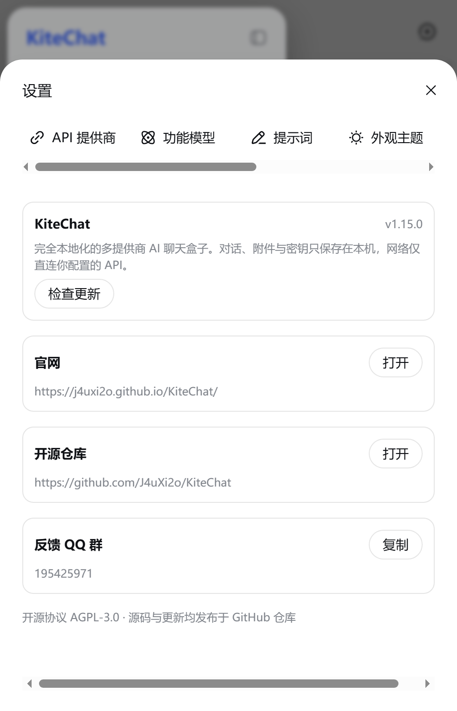

<div align="center">


# KiteChat

**完全本地化的多提供商 AI 聊天盒子 · Android**

[](LICENSE)
[](https://github.com/J4uXi2o/KiteChat/releases)
[](https://github.com/J4uXi2o/KiteChat/releases)

[官网下载](https://j4uxi2o.github.io/KiteChat/) · [网页版试用](https://j4uxi2o.github.io/KiteChat/app/) · [更新日志](https://github.com/J4uXi2o/KiteChat/releases) · [English](README.en.md)

</div>

---

## 简介

KiteChat 是一款运行在 Android 上的开源 AI 客户端。它不绑定任何一家模型服务：聊天、识图、生图、联网搜索、语音输入与朗读各自独立绑定提供商与模型，一台设备即可同时使用 DeepSeek、OpenAI、硅基流动、基元律动、本地 Ollama 等多家服务。

所有对话、附件与 API Key 仅保存在设备本机；网络请求只发往你自己配置的接口地址。无账号体系、无遥测上报、无云同步。

## 功能特性

**模型接入**
- 多提供商预设与任意 OpenAI / Anthropic 兼容端点自定义接入
- 功能槽位独立绑定：聊天 / 识图 / 生图 / 标题生成 / 联网搜索 / 语音互不干扰
- 首次启动粘贴一个 DeepSeek Key，一键配齐聊天、识图、标题、搜索与语音
- 深度思考按厂商协议自动适配，思考过程独立展示

**对话体验**
- 流式回复、随时停止（真实取消请求）、重新生成与继续生成
- 图片 / PDF / Word 附件解析提问；粘贴网址自动读取正文作为上下文
- 微信式语音输入：按住说话、上滑取消、松手自动转写发送
- 语音朗读，音色按各厂商官方文档内置，支持自定义音色 ID
- 系统级文本划选复制、长按操作菜单、会话分支切换

**图片生成**
- 尺寸与张数由语言模型根据你的描述自动推断，原始提示词不被改写
- 参考图图生图，跨厂商适配（OpenAI / 基元律动 / 硅基流动）
- 生成结果一键保存系统相册

**个性化与系统集成**
- 深浅色主题、自定义调色板与主题变量、字号圆角调节
- 安卓系统分享接入、生成完成通知、安全区与键盘自适应
- 会话与附件本地导入导出（ZIP），数据完全可迁移

## 界面预览

<div align="center">



</div>

## 下载安装

从 [Releases](https://github.com/J4uXi2o/KiteChat/releases) 或 [官网](https://j4uxi2o.github.io/KiteChat/) 下载 APK。覆盖安装保留全部本地数据。

系统要求：Android 8.0（API 26）及以上。

## 从源码构建

环境要求：Node.js 20+、JDK 21、Android SDK 35。

```bash
npm install
npm run build            # 构建 Web 产物
npx cap sync android     # 同步至安卓工程
cd android && ./gradlew assembleRelease
```

Release 签名配置见 `android/signing.properties.example`。

## 项目结构

```
src/                  Web 前端（React 18 + TypeScript + zustand）
  services/           提供商网关 / 会话存储 / 语音 / 搜索 / 附件解析
  components/         界面组件
android/              Capacitor 安卓工程（原生桥：HTTP / 存储 / 通知 / 分享）
docs/                 官网静态页
```

## 反馈

QQ 群：**195425971** · [Issues](https://github.com/J4uXi2o/KiteChat/issues)

## 许可证

[AGPL-3.0](LICENSE)

---

<sub>部分代码源自 [deepseek-ai/chat-demo](https://github.com/deepseek-ai/chat-demo)（MIT），第三方许可声明见 [THIRD_PARTY_NOTICES.md](THIRD_PARTY_NOTICES.md)。</sub>